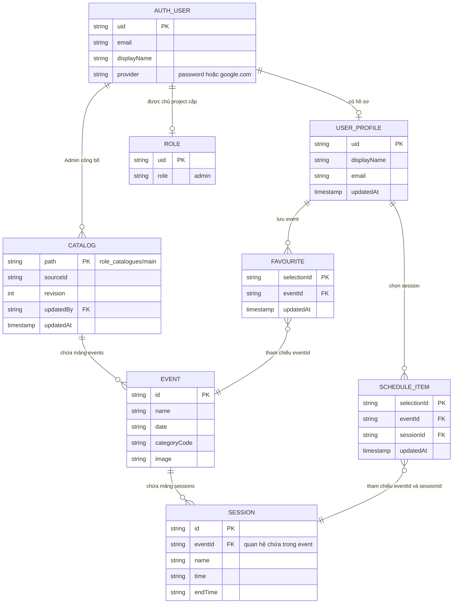

# Database và phân quyền — nhánh CW-auth

Bản có tài khoản nằm ở nhánh CW-auth. Nhánh CW vẫn giữ bản coursework không có đăng nhập.

## Sơ đồ

Đây là sơ đồ logic. Firestore là NoSQL: EVENT/SESSION là các phần tử trong mảng của document danh mục, không phải bảng SQL riêng. Firebase Authentication quản lý mật khẩu và token; không lưu mật khẩu trong Firestore.

## Đường dẫn dữ liệu

- Firebase Authentication: tài khoản có UID ổn định, email/password hoặc Google.
- roles/{uid}: document do chủ project quản lý; role: admin. Không có document này nghĩa là quyền User. Client không có quyền tự tạo/sửa role.
- users/{uid}: hồ sơ hiển thị email, displayName, updatedAt. Không chứa role.
- users/{uid}/favourites/{selectionId}: eventId, updatedAt.
- users/{uid}/schedule/{selectionId}: eventId, sessionId, updatedAt.
- role_catalogues/main: danh mục của CW-auth, cấu trúc event/session giữ nguyên, thêm updatedBy là UID Admin.
- selectionId là base64url của JSON [eventId] hoặc [eventId, sessionId]; cùng lựa chọn dùng lại cùng ID, tránh nhân bản.
- ID tham chiếu được giữ khi event/session tạm bị xóa; UI chỉ hiển thị bản ghi còn trong danh mục. Khi Admin cập nhật giờ, cảnh báo trùng lịch tính lại từ dữ liệu mới.

## Quyền

- Chưa đăng nhập: chỉ thấy màn đăng nhập của CW-auth.
- User: đăng ký Email/Password hoặc đăng nhập Google, xem danh mục; chỉ đọc/ghi lịch và yêu thích của chính UID.
- Admin: đăng nhập app quản trị bằng tài khoản được cấp quyền; CRUD SQLite, công bố và tự đồng bộ danh mục. Có thể dùng app User như người tham dự.
- Firestore Rules kiểm tra UID cho mọi truy cập dữ liệu riêng, kiểm tra roles/{uid} khi công bố. Thay role trong request/hồ sơ không nâng quyền.
- App Admin chỉ có đăng nhập, không có tự đăng ký Admin.
- Dữ liệu SQLite Admin vẫn là một bộ dữ liệu công bố chung, không tách database riêng theo từng Admin. Ràng buộc sourceId/revision chống đè nhầm bản Cloud vẫn giữ nguyên.

## Lưu và đồng bộ

Mỗi lựa chọn là một document riêng. Hai thiết bị thêm hai session khác nhau không ghi đè cả danh sách. Hai thiết bị sửa cùng lựa chọn: Firestore nhận thao tác sau cùng.

Firestore SDK lưu cache và hàng đợi khi offline. App hiển thị trạng thái đang chờ Cloud; không coi ghi cache là đã đồng bộ. Đăng xuất chờ các thao tác đang gửi được xác nhận, tránh mất thay đổi khi đổi tài khoản.

Tài khoản mới không tự nhận lịch chung cũ trên máy. Trong Tài khoản có nút Nhập lịch & yêu thích cũ từ máy, xác nhận email đích trước khi nhập. Dữ liệu cũ không bị xóa.

## Tách bản CW

catalogues/main và sync_writes/current thuộc bản CW cũ; quyền theo khóa công bố của bản đó giữ nguyên. CW-auth chỉ đọc/ghi role_catalogues/main và các collection tài khoản, không dùng khóa ghi nhúng APK. Hai danh mục độc lập để chạy/so sánh hai nhánh; chỉnh bản CW không tự cập nhật danh mục CW-auth.

## Cấp Admin

Email được người dùng chọn: truongtdgch210108@fpt.edu.vn. Chủ project tra UID trong Authentication và tạo roles/{uid} với role: admin bằng Firebase Console/Owner API. Không cấp quyền theo email được nhập vào UI, không cho client nâng quyền.

Để thu hồi: xóa document role hoặc đổi giá trị role khác admin. Rules chặn lần ghi tiếp theo; app Admin theo dõi thay đổi và đưa về đăng nhập.

## Cấu hình Google

Bật Google provider và Email/Password trong Authentication, đăng ký SHA-1/SHA-256 của chứng thư ký APK User trong Firebase. Web OAuth client ID là cấu hình công khai, không phải client secret. Máy clone ký bằng chứng thư khác phải đăng ký SHA của máy đó. Không đưa keystore, token CLI hoặc client secret vào Git.

## Kiểm chứng cần chạy

- Firebase Rules: User A không đọc/ghi User B; User không tự cấp Admin hoặc công bố; Admin công bố được; thu hồi role chặn ghi.
- Hai Firebase app client đăng nhập cùng UID: thêm/bỏ yêu thích và lịch thấy trên cả hai.
- Đổi UID: không thấy dữ liệu tài khoản trước; offline xếp hàng, nối mạng đẩy lên; đăng xuất bảo vệ hàng đợi.
- UI đăng ký/đăng nhập/Google và lỗi đầu vào; build Admin Java, User Flutter.
